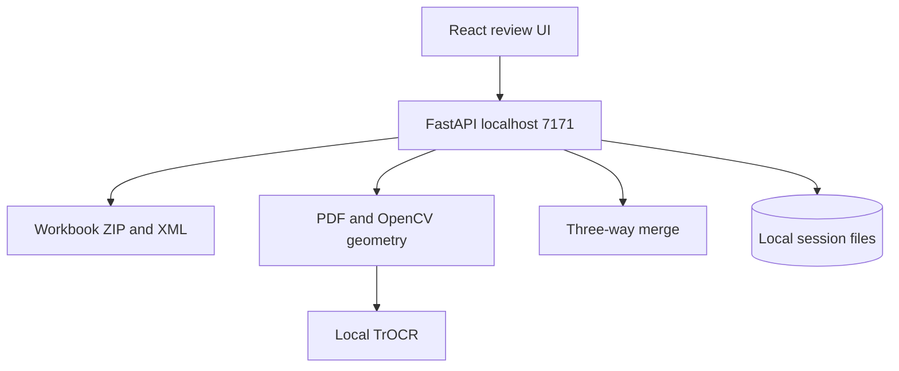
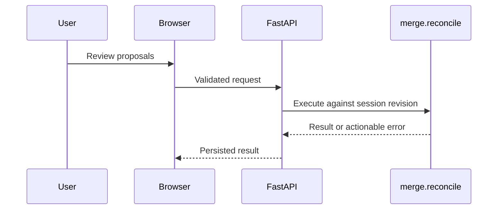
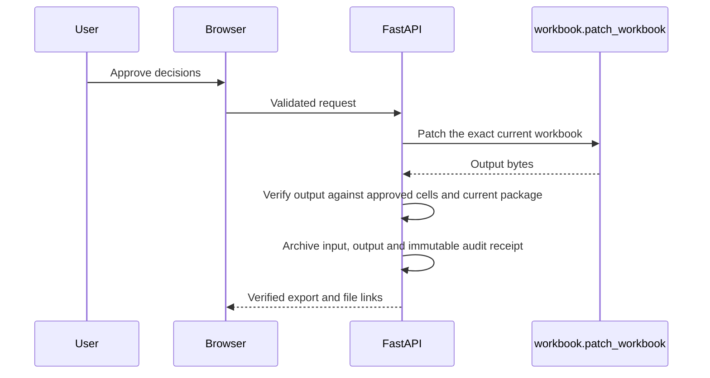
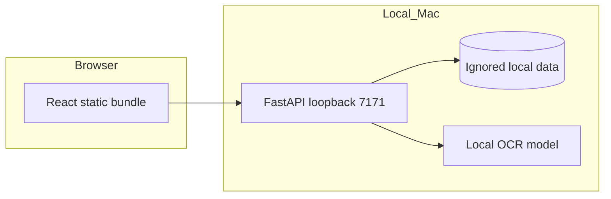

# PaperPatch architecture

## System overview

React/Vite review UI calls one loopback FastAPI service. Python owns workbook identity, print geometry, local recognition and approval validation. Output begins with the current working workbook, initially the latest upload. Each successful export promotes its output to the working copy; the printed baseline stays immutable.

## Components

| Name | Purpose | Owns | Depends on | Lives in |
|---|---|---|---|---|
| Review UI | Configure, scan, approve | In-progress decisions | API | src/App.tsx |
| API/session | Validate revisions and persist state | Session files | All backend modules | backend/main.py |
| Workbook | Typed table and targeted patching | Workbook package operations | lxml, zipfile | backend/workbook.py |
| Merge | Compare and validate approval | Pure rules | Typed tables | backend/merge.py |
| Export verification | Check actual output against approved changes | Read-only package and XML comparisons | Workbook parsing helpers | backend/verification.py |
| Paper | Fixed layout, alignment, crops, recognition | Print manifest and model cache | ReportLab, OpenCV, TrOCR | backend/paper.py |

## Request lifecycles

### Open workbook — 2 seconds

### Generate paper — 2 seconds

### Process photograph — 60 seconds warm

### Reconcile edits — 500 ms

### Export workbook — 2 seconds

Export verification allows approved cell values and the required workbook recalculation flags to change. It checks all remaining worksheet structure and text, formula expressions, package membership, and unrelated ZIP payloads. A failed check stops before export files or session state are written. It does not validate handwriting accuracy or calculate formula results.

## State topology

| State | Logical owner | Physical home | TTL | Failure mode |
|---|---|---|---|---|
| Baseline/current | Service | .data/sessions/ID/*.xlsx | Until locally removed | Must upload again |
| Configuration/manifest | Service | session.json | Session lifetime | Cannot identify paper |
| Scan/crops | Service | scans/ and crops/ | Session lifetime | Retake scan |
| Accepted receipts | Service | session.json | Session lifetime | Replay protection lost if session deleted |
| Review decisions | Service | Session JSON with cell/evidence fingerprints | Until relevant source or cell changes | Review again |
| Reading drafts | Browser | Validated localStorage with candidate/box identity | Until saved or discarded | Unsaved warning if browser storage fails |
| Export evidence | Service | Archived input/output XLSX and immutable audit JSON | Session lifetime | Earlier exports without verification remain labeled as such |
| Active session | URL | ?session=ID | Browser history | Open session link |
| OCR model | Service | Hugging Face local cache | Until removed | Download needed |

## Deployment topology

The first build has no hosted service, account or remote storage. Uploaded workbooks stay on this machine. Only initial dependency/model downloads need network access. Bind loopback; public hosting is a future separate step.

## Decision log

| Decision | Rationale | Alternatives | Date |
|---|---|---|---|
| React/Vite + FastAPI | One production service; direct Python image tooling | Next with separate API; all-TS | 2026-11-12 |
| Targeted OOXML patch | Preserve unrelated workbook parts | openpyxl/ExcelJS round trip | 2026-11-12 |
| Fixed paper geometry | Reliable crop identity | Arbitrary Excel photo extraction | 2026-11-12 |
| Local TrOCR | No paid credentials; honest handwriting proposals | Cloud OCR; Tesseract | 2026-11-12 |
| Session JSON with serialized mutations | Small local proof needs no database | SQLite/cloud DB | 2026-11-12 |
| Kiro owns workbook + merge | Substantive competition tooling use | Retrospective provenance files | 2026-11-12 |

## Out of scope

Arbitrary print layouts, ID changes, row insertion/deletion, formula evaluation, accounts, cloud storage and deployment are excluded to make the round trip verifiable. Real handwritten phone photos still require empirical validation.
