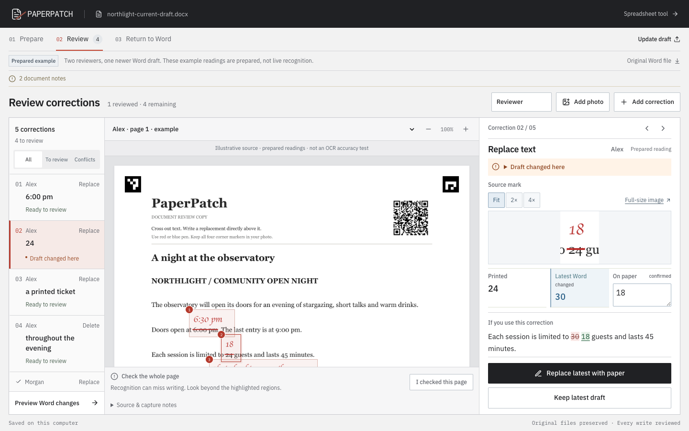

# PAPERPATCH | Paper to Word

**[Download the v0.2.1 test build](https://github.com/Smokeybear10/410.PROJ.paperpatch/releases/latest)** · **[Watch the handwriting walkthrough](https://www.youtube.com/watch?v=8ynWF660iV0)**

Review handwritten corrections against Word drafts, or transcribe a handwritten page into an editable document.



A printed draft says **24 guests**. Someone writes **18** on paper while another editor changes Word to **30**. PaperPatch shows all three versions together. You decide which one belongs in the document; unrelated edits stay intact.

## Quick Start

Requires Python 3.12, Node.js 22+, npm, and [uv](https://docs.astral.sh/uv/getting-started/installation/).

```bash
git clone https://github.com/Smokeybear10/410.PROJ.paperpatch.git
cd 410.PROJ.paperpatch
uv sync --frozen
npm ci
npm run setup:document-ocr
npm start
```

Open http://localhost:7171 and choose **Open Word file** or **Open handwriting**.

No API key is required. OCR setup downloads two pinned PP-OCRv6 models; recognition runs locally afterward. Skip `npm run setup:document-ocr` to use the prepared example or enter corrections manually. Document reviews stay in `.data/documents/`; handwritten-page transcriptions stay in `.data/transcriptions/`.

The v0.2.1 test build includes both handwritten-page transcription and paper-correction review. The older v0.1.1 release only contains the correction workflow.

The [release ZIP](https://github.com/Smokeybear10/410.PROJ.paperpatch/releases/latest/download/paperpatch-test-build.zip) includes the compiled interface. With `uv` installed, extract it and run `./run-paperpatch.sh` from its `paperpatch` directory; Node.js is not needed. Initial setup requires internet access. Use `./run-paperpatch.sh --skip-ocr` for the prepared example. The launcher has been checked on macOS; Linux and Windows execution have not been validated.

## What It Does

**Review paper corrections**

- Open a `.docx`, print its review PDF, and mark short replacements in red or blue pen. Upload photographs of the marked pages.
- Compare the printed text, the latest Word text, and the paper reading in one workspace. Correct a reading and preview the resulting sentence before accepting it.
- Resolve competing reviewers' corrections, unexplained pen marks, and missing targets. Add missed corrections manually and check each page before export.
- Load a newer Word draft at any point. PaperPatch rematches the corrections and resets approvals when their targets change.

**Return to Word**

- Download tracked changes attributed to each reviewer, a clean copy, the original input, and a JSON audit record.
- Preserve unrelated changes and document parts. Export checks verify the approved text and that rejecting the revisions restores the original text and formatting.
- Block export while readings, pages, marks, or overlapping corrections still need review.

**Transcribe a handwritten page**

- Upload a real scan or photograph directly, without an existing Word draft. The local reader detects text lines and reads their actual image crops.
- Rotate, straighten, and crop the reading copy before recognition. Auto straighten suggests an angle for you to check in the preview; manual adjustment stays available. The original uploaded file stays intact.
- Compare the original page and each crop with its reading. Correct mistakes, add missed text, omit false detections, and check the entire page before export.
- Adjust a detected line's selection and read it again. Accept or reject the new suggestion explicitly; the initial machine reading and retry history remain available. Accepting a suggestion still requires confirmation before export.
- Download editable Word text with the reviewed paragraph order and source line breaks. The original upload, raw OCR, and reviewed text remain available separately.

The working example contains prepared readings and illustrative pen marks. It exercises review, conflicts, and export without running OCR. The original 1:59 demo records the earlier correction workflow, including tracked and clean Word downloads. **Try a real-pen check** opens a separate capture exercise with no prepared readings.

## Limits

Handwriting recognition can miss or misread writing; every automatic reading needs confirmation. A physically printed, pen-written, phone-photographed round trip has not yet been validated. Document preservation checks do not establish handwriting accuracy.

In a November 17 development check using 48 human handwriting crops composited onto generated pages, capture located all 48 targets. The primary reading was exact on 23; the correct text appeared in either suggestion on 27. These were known development examples, not a held-out or physical-camera accuracy result. The remaining 21 needed manual transcription beyond either suggestion.

Word files must be under 10 MB, with at most 60 body paragraphs and eight review pages. Edits are limited to ordinary text paragraphs. Tables, fields, hyperlinks, existing tracked changes, and other complex content remain protected. The review PDF reflows body text rather than reproducing the original Word layout.

Photos must be JPEG, PNG, or WebP, under 20 MB and 25 megapixels. Automatic correction capture needs the corner markers and print-run QR code; ordinary photos use manually selected handwriting regions and Word targets. Full-page transcription uses separate line detection and works best with straight, single-column pages. Preparation supports quarter turns, up to 15 degrees of manual straightening, and a rectangular crop; it does not correct perspective or restore blurred detail. Small scans, cursive writing, columns, and crowded lines can require substantial correction. The reader processes at most 120 detected lines per page; review allows up to 240 lines including manual additions.

PaperPatch runs locally on this computer. Transfer phone photos here before uploading; it is not a hosted multi-user service.

## Tech Stack

| Layer | Tools |
|-------|-------|
| Interface | React, TypeScript, Vite |
| Local API and review state | FastAPI, Pydantic, local files |
| Word edits | lxml, targeted OOXML changes |
| PDF and photo alignment | ReportLab, PyMuPDF, OpenCV |
| Handwriting | PP-OCRv6, ONNX Runtime |

## Project Structure

```text
src/DocumentApp.tsx          Document review interface
src/TranscriptionApp.tsx     Handwritten-page review interface
backend/documents.py        Review state, decisions, and export gates
backend/transcription.py     Page recognition, review, and new Word documents
backend/transcription_image.py  Photo preparation with the original retained
backend/docx_engine.py       Word matching, tracked changes, and verification
backend/document_capture.py Photo alignment and correction detection
backend/document_ocr.py     Local handwriting recognition
.kiro/                      Specs and recorded Kiro sessions
scripts/package-release.py  Build the downloadable test archive
```

Run `npm run build` to check TypeScript and compile the interface. Package committed source with `npm run package -- --output /absolute/path/paperpatch.zip`.

The earlier Excel workflow remains at `/?mode=workbooks`. Stop the Word server, run `npm run setup:ocr`, then `npm run start:workbooks` to install and use its separate PyTorch/TrOCR reader. Workbook sessions stay in `.data/sessions/`.

## Kiro

Kiro implemented the initial Word inspection, three-way matching, and tracked-revision engine. The [Word session record](.kiro/evidence/word-revisions-session.txt) preserves that work and its original limits. Codex subsequently hardened matching, protected-content handling, export verification, and clean-copy export, and built capture, OCR integration, the API, and the interface.

For v0.2.0, Kiro implemented the line-selection retry API, candidate history, and review gates in a scoped CLI session. Codex reviewed and corrected synchronization, failure handling, and resource cleanup, then built the photo preparation and interface. The [session receipt](.kiro/evidence/region-recovery-session.jsonl) and [verification record](.kiro/evidence/region-recovery-verification.json) distinguish those contributions. The backend passed 44 isolated checks, including one real local OCR retry; this is not a handwriting accuracy benchmark.

Kiro also built the original [workbook merge modules](.kiro/evidence/workbook-merge-session.md) and [export verifier](.kiro/evidence/export-verifier-session.txt). The current implementation contract is in [`.kiro/specs/paperpatch/`](.kiro/specs/paperpatch/); historical session records describe the code at the time they were recorded.

## License

[AGPL-3.0](LICENSE). Copyright 2026 Thomas Ou.

PyMuPDF uses its [AGPL distribution](https://pymupdf.io/licensing). Downloaded [PP-OCRv6 models](https://huggingface.co/PaddlePaddle/PP-OCRv6_medium_rec_onnx) use Apache-2.0; optional TrOCR models retain their upstream terms. Fonts retain their SIL Open Font License notices in `public/fonts/`. The release includes PaperPatch source; dependencies and model weights are installed separately.

Built by Thomas Ou
